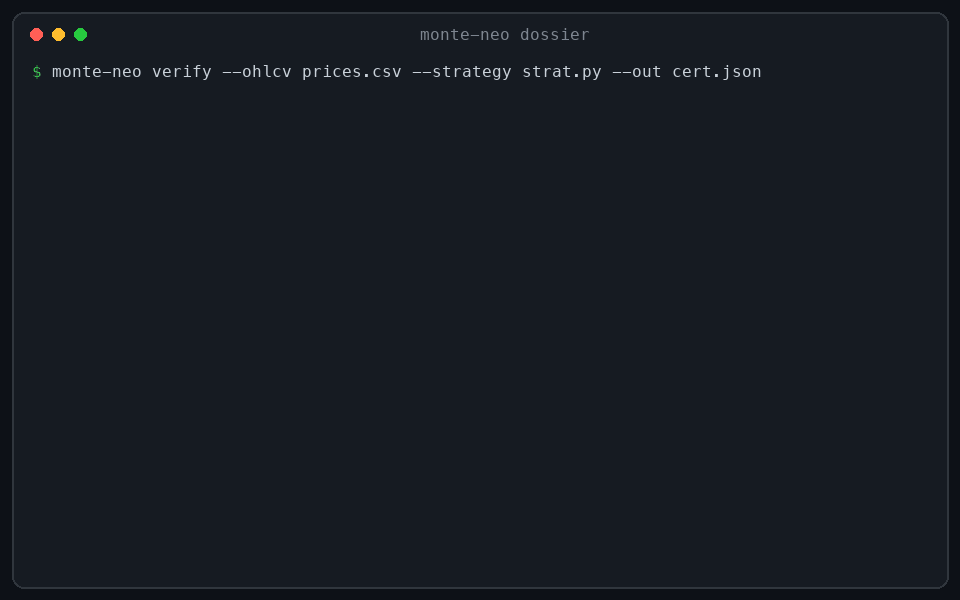

# Validation dossier, Alpha Readiness Level and live monitoring

Three tools for the steps after a backtest is verified: putting it before a committee, saying where it stands on the
way to capital, and watching it once it trades.

## `monte-neo dossier`: one folder for a committee, a validator or an auditor



```bash
monte-neo dossier --demo --framework sr11-7                 # no files
monte-neo verify --ohlcv data.csv --strategy s.py --out cert.json
monte-neo dossier --certificate cert.json --framework ss1-23 --name "Momentum 20" --owner "Desk A" \
  --purpose "Daily futures overlay" [--alpha alpha.json] [--live live.json] --out dossier/
```

The folder holds:

- `dossier.html`, one page with no scripts and no network, printable to PDF: the verdict, purpose and scope, the
  results, every check, the Alpha Readiness Level, the framework map, the assumptions and limitations, how to
  reproduce, and blank sign-off fields;
- `dossier.json` (`validation-dossier/1`), the certificate itself, `environment.json` (Python, platform, package
  versions), `REPRODUCE.md` (the exact command and the expected certificate id) and `limitations.md`.

Frameworks (`--framework`):

| Name | Framework |
|------|-----------|
| `generic` | Data, look-ahead, economics, statistics, claims, policy, reproducibility, monitoring |
| `sr11-7` | Federal Reserve SR 11-7 / OCC 2011-12, model risk management |
| `ss1-23` | PRA SS1/23, model risk management principles for banks |
| `rts6` | MiFID II RTS 6 (Delegated Regulation 2017/589), testing of algorithms |
| `crypto` | A checklist for crypto funds and desks: 24/7 data, funding, venue latency, delisted tokens, crash stress |
| `academic` | A paper's appendix: pre-registration, trials disclosed, out-of-sample, the t ≥ 3 hurdle, reproducibility |

`--lite` also writes `dossier-lite.html`, one plain-language page for a reader who is not a quant (a family office, a
board), with the notice in a box at the top.

The map shows, per clause, whether the dossier holds **evidence** for it (`covered`, `partial`, `not covered`) and what
that evidence says. Clauses that need a person, such as conceptual soundness or governance, are never shown as fully
covered. **A dossier is evidence for a validation, not a statement that anyone complies with a framework.**

MCP tool: `build_dossier`.

### Extended dossier

```bash
monte-neo dossier --certificate best.json --also other1.json other2.json --research my_project/ --portfolio portfolio.json --framework sr11-7 --out dossier/
```

Adds, to the same folder, an `extended` block in `dossier.json` (`extended-dossier/1`) and the matching HTML sections: the search funnel
and its cost (from a `monte-neo research` project), ARL and depth by level with the reason of every criterion for each certificate,
regimes, costs, capacity, the portfolio report and the live-monitoring report. A section you did not supply is shown as *not provided*,
never left out silently. The SR 11-7 or SS1/23 map is an **evidence map**: which clause has which evidence in the dossier. It is not a
compliance statement or a model approval.

## Alpha Readiness Level (ARL 1–9)

> The Alpha Readiness Level (ARL) was devised by Rostyslav Shcherbyna, author of Monte-Neo; it is modelled on the idea of a technology readiness level and is a Monte-Neo scale, not an industry standard.

The rules live in one file, `src/monte_neo/arl_rules_v2.json` (`arl-rules/2`, provisional); the full page with the depth criteria is [ARL and depth](arl.md). The table below is generated from it.

Every `alpha` report and every dossier carries an ARL: where the evidence stands on the way from an idea to capital.

<!-- arl:levels:start -->
| L | Name | Required checks (alternatives joined by "or") |
|---|------|------------------------------------------------|
| 1 | Idea on clean data | `data_integrity` or `ic` |
| 2 | The backtest is not broken | `lookahead_truncation` or `universe_lookahead` |
| 3 | It earns after costs | `net_profitability` or `market_impact` + `cost_sensitivity` |
| 4 | The signal predicts | `ic` + `signal_placebo` or `timing_significance`; `selection_adjusted_sharpe` |
| 5 | It is new alpha | `residual_alpha` + `hidden_short_volatility` |
| 6 | It survives the search | `deflated_sharpe` or `hlz_hurdle` + `min_backtest_length` |
| 7 | Tradable and robust | `market_impact` or `capacity`; `synthetic_market_null` + `universe_subsampling` + `start_date_sensitivity` or `period_consistency` + `delay_sensitivity`; `rebalance_timing_luck` or `cost_margin` |
| 8 | It adds to your book | `marginal_sharpe` |
| 9 | Confirmed live | `live_vs_backtest` + `alpha_death_monitor` + `live_source` |
<!-- arl:levels:end -->

The level is the highest one met together with every level below it. Missing evidence is **not assessed**, never
passed, and the report names the run that would produce it, for example
`ARL 6/9 — blocked at 7: tradable and robust (rebalance_timing_luck)`.

The ARL rates the evidence, not the investment.

Each level also has a depth from 0 to 4 (`ARL 6, depth 3/4`); a depth never lifts the level, and a criterion without evidence scores 0 and says which command would produce it.

**Ceilings.** A universe whose symbols all trade to the last bar, with no list of the delisted or dropped names
(`delisted=[...]` in `verify_strategy`), may be today's survivors: the `survivorship` row warns and the level is
capped at 4 until the missing names are added or declared. With a declared list the row prices the bias (an
estimate from an assumed delisting return, see `verify/survivorship.py`) and fails when it removes the profit.

## `monte-neo monitor`: after launch

```bash
monte-neo monitor --certificate cert.json --live live.csv [--fills fills.csv] [--haircut 0.5] [--out live.json]
```

`live.csv` has live or paper returns (date, return). `fills.csv` has timestamp, symbol, side, quantity, price and,
for slippage, the decision price `reference_price`.

| Check | What it says |
|-------|--------------|
| `live_vs_backtest` | Correlation, tracking error and the mean difference against the backtest on the same dates |
| `implementation_shortfall` | Realised slippage against the modelled one, and the value to use instead |
| `live_source` | Where the live data comes from (`--source real_fills|paper|testnet|simulated`, or a `source` column) and whether it can support ARL 9 |
| `alpha_death_monitor` | Sequential alarms (CUSUM, SPRT) against the backtest edge shrunk by `--haircut`, with the date of the alarm |
| `live_track_needed` | How much live history is still needed to tell the edge from zero |

Exit code 0 means no warning and 2 means a warning, so it can run from cron or CI. MCP tool: `monitor_live`.

Not investment advice: a research example, not a call to trade or a promise of profit. Simulated results do not
predict future returns.

## How to honestly get ARL 9

ARL 9 ("confirmed live") needs `live_source` to pass, and it passes only when all of these hold:

1. **Source is `real_fills`**: orders sent to a real venue with real money, however small. `paper` (fills at prices the
   market may never have offered, no queue, no rejections, no impact) and `testnet` (its own order book, liquidity and
   latency: it proves the code runs, not that the orders are executable at these prices and sizes) stop at **ARL 8**,
   and so does `simulated`. A live file with no stated source is treated the same way.
2. **Enough live bars**: at least 60, and at least the number `live_track_needed` reports (the bars needed to tell the
   haircut Sharpe from zero at 95 %).
3. **Enough fills to judge costs**: at least 30 real fills with the decision price in `reference_price`, passed with
   `--fills`, and a realised slippage within 1.5 times the modelled one (`implementation_shortfall`). If it is higher,
   re-run `verify` with the recommended `slippage_bps` and see whether the edge survives.
4. **`live_vs_backtest` and `alpha_death_monitor`** without a warning.
5. For depth D4 of level 9, a **custody statement** (`--custody`) that the fills are held at a real venue or broker. At least 6 months and 100 fills live give D3.

```bash
monte-neo monitor --certificate cert.json --live live.csv --fills fills.csv --source real_fills --custody "broker statement 2026-11" --out live.json
monte-neo dossier --certificate cert.json --live live.json --out dossier/
```

Rebalance-day luck, selection vs timing and the alpha after two betas (basket and a reference asset such as BTC,
`reference_symbol="BTCUSDT"`) are checked at ARL 7 and below; see [Gates](gates-alpha-cost-regime.md).
