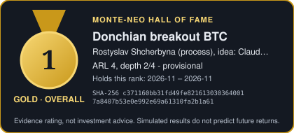
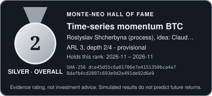
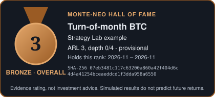
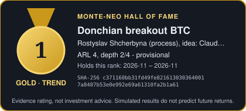
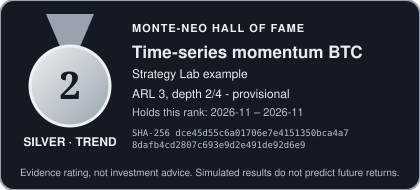
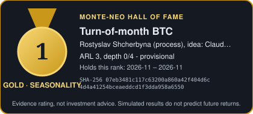

# Hall of Fame

> Not investment advice: a research example, not a call to trade or a promise of profit. Simulated results do not predict future returns.

The Hall of Fame ranks strategies by the **evidence** in their Monte-Neo certificate (ARL, depth, Deflated Sharpe after paying for
`n_trials`), never by return. The strategy itself is not shown. Rules `hall-of-fame/1` (provisional) with ARL rules
`arl-rules/1` (provisional): the order can change when the rules are calibrated, and then a new table starts and this one is archived.
How to join: [the guide](https://github.com/NeoZorK/Monte-Neo/blob/main/docs/guides/hall-of-fame.md). This page is generated by `monte-neo hall build`; do not edit it by hand.

## Top 10 overall

| Rank | Strategy | Author | Category | ARL / depth | Deflated Sharpe | Tier | Holds this rank | Certificate SHA-256 |
|---|---|---|---|---|---|---|---|---|
| 🥇 1 | Donchian breakout BTC | Strategy Lab example | trend | ARL 4, depth 2/4 (provisional) | 0.856 | B privately verified | 2026-11 – 2026-11 | `c371160bb31fd49f…` |
| 🥈 2 | Time-series momentum BTC | Strategy Lab example | trend | ARL 3, depth 2/4 (provisional) | 0.474 | B privately verified | 2026-11 – 2026-11 | `dce45d55c6a01706…` |
| 🥉 3 | Turn-of-month BTC | Strategy Lab example | seasonality | ARL 3, depth 0/4 (provisional) | 0.153 | B privately verified | 2026-11 – 2026-11 | `07eb3481c117c632…` |

Not investment advice: a research example, not a call to trade or a promise of profit. Simulated results do not predict future returns.

## Top 10 by category

### trend

| Rank | Strategy | Author | Category | ARL / depth | Deflated Sharpe | Tier | Holds this rank | Certificate SHA-256 |
|---|---|---|---|---|---|---|---|---|
| 🥇 1 | Donchian breakout BTC | Strategy Lab example | trend | ARL 4, depth 2/4 (provisional) | 0.856 | B privately verified | 2026-11 – 2026-11 | `c371160bb31fd49f…` |
| 🥈 2 | Time-series momentum BTC | Strategy Lab example | trend | ARL 3, depth 2/4 (provisional) | 0.474 | B privately verified | 2026-11 – 2026-11 | `dce45d55c6a01706…` |

Not investment advice: a research example, not a call to trade or a promise of profit. Simulated results do not predict future returns.

### mean-reversion

_No ranked entries yet._

Not investment advice: a research example, not a call to trade or a promise of profit. Simulated results do not predict future returns.

### carry

_No ranked entries yet._

Not investment advice: a research example, not a call to trade or a promise of profit. Simulated results do not predict future returns.

### pairs

_No ranked entries yet._

Not investment advice: a research example, not a call to trade or a promise of profit. Simulated results do not predict future returns.

### cross-sectional

_No ranked entries yet._

Not investment advice: a research example, not a call to trade or a promise of profit. Simulated results do not predict future returns.

### seasonality

| Rank | Strategy | Author | Category | ARL / depth | Deflated Sharpe | Tier | Holds this rank | Certificate SHA-256 |
|---|---|---|---|---|---|---|---|---|
| 🥇 1 | Turn-of-month BTC | Strategy Lab example | seasonality | ARL 3, depth 0/4 (provisional) | 0.153 | B privately verified | 2026-11 – 2026-11 | `07eb3481c117c632…` |

Not investment advice: a research example, not a call to trade or a promise of profit. Simulated results do not predict future returns.

### other

_No ranked entries yet._

Not investment advice: a research example, not a call to trade or a promise of profit. Simulated results do not predict future returns.

## Medal badges

**🥇 Donchian breakout BTC (overall)**

```markdown

```

**🥈 Time-series momentum BTC (overall)**

```markdown

```

**🥉 Turn-of-month BTC (overall)**

```markdown

```

**🥇 Donchian breakout BTC (trend)**

```markdown

```

**🥈 Time-series momentum BTC (trend)**

```markdown

```

**🥇 Turn-of-month BTC (seasonality)**

```markdown

```

## Past medals

_No medal has changed hands yet._

## Self-reported (tier C, not ranked)

_None._

## Not ranked (duplicates, limits, REJECT)

_None._

## Archived tables

_None yet._
