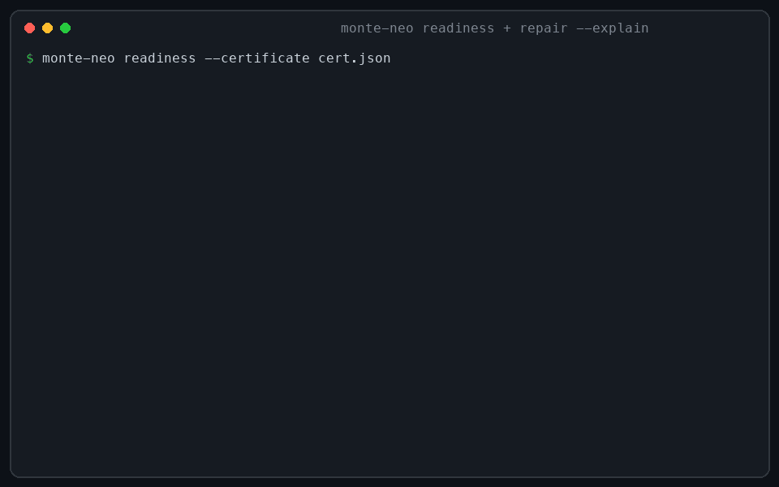
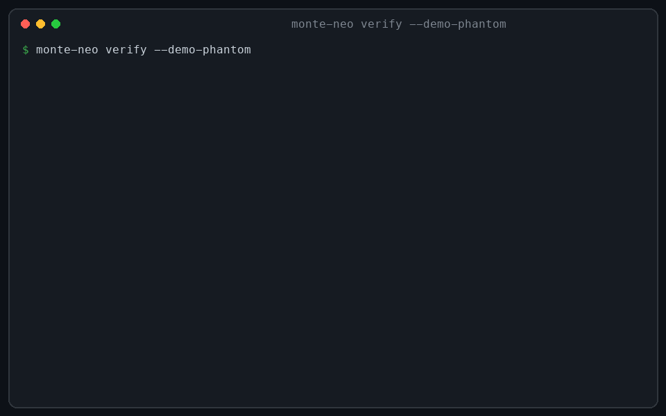
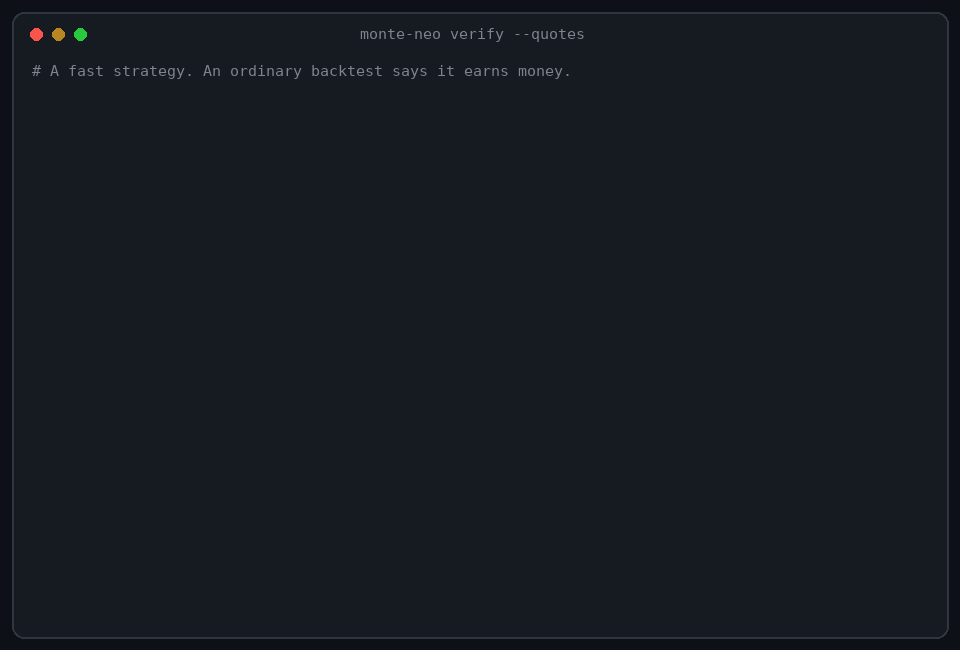
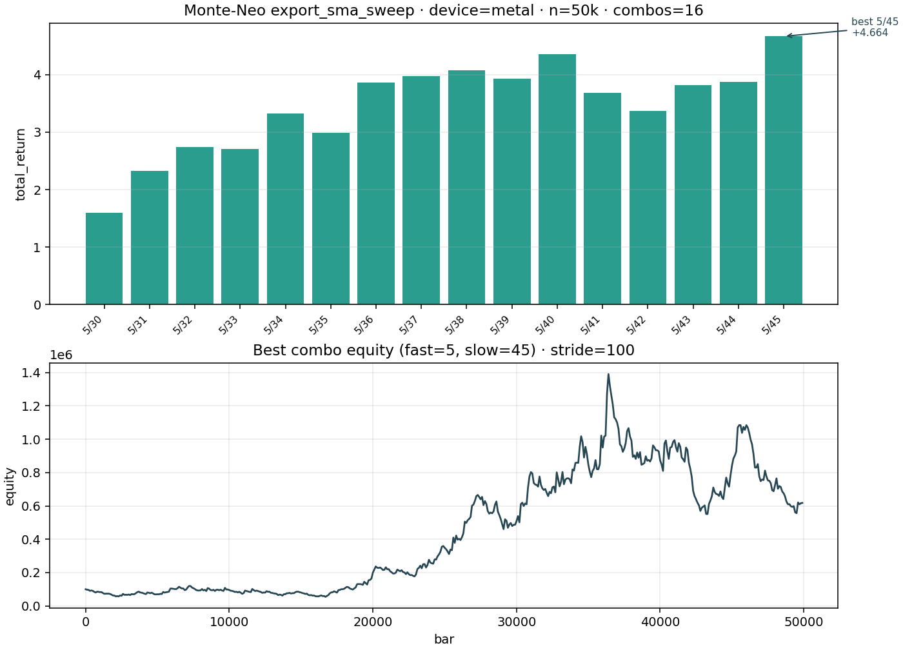
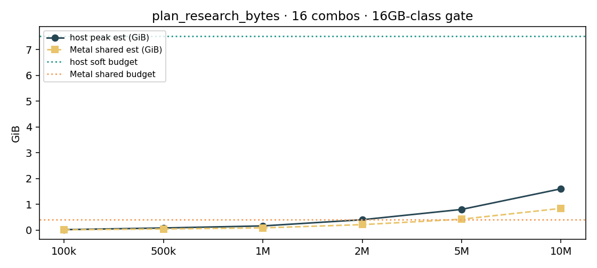

# Monte-Neo

<p class="mn-hero-logo" markdown="1">
{ width="120" }
</p>

<p class="mn-tagline" markdown="1">
**The independent verifier for trading strategies written by AI agents and humans**  
Catch look-ahead bias, hidden trading costs and overfitting before a backtest reaches your money
</p>

<p class="mn-badges" markdown="1">
[](https://pypi.org/project/monte-neo/)
[](https://pepy.tech/projects/monte-neo)
[](https://pypistats.org/packages/monte-neo)
[](https://github.com/NeoZorK/Monte-Neo/actions/workflows/ci.yml)
[](https://registry.modelcontextprotocol.io/v0/servers?search=io.github.NeoZorK/monte-neo)
[](https://github.com/NeoZorK/Monte-Neo/blob/main/LICENSE)
[](https://github.com/NeoZorK/Monte-Neo/actions/workflows/ci.yml)
[](https://pypi.org/project/monte-neo/)
[](https://github.com/NeoZorK/Monte-Neo/pkgs/container/monte-neo-verify)
[](https://github.com/NeoZorK/Monte-Neo/releases/latest)
</p>

!!! tip "Install"
    ```bash
    pip install monte-neo
    monte-neo verify --ohlcv prices.csv --strategy my_strategy.py --n-trials 12
    ```

## The problem

A coding agent can turn a trading idea into a backtest in minutes, and then report a Sharpe
of 3. Most of the time that number is wrong:

- **Look-ahead bias:** the code reads future bars (`shift(-1)`, centred windows, `bfill`,
  whole-series statistics, `np.gradient`, FFT filters).
- **Missing costs:** the edge is smaller than fees and slippage, or needs a perfect fill.
- **Selection bias:** the best of 300 variants is reported as if it were the only one.

## What Monte-Neo does

It checks the backtest, not the idea. Give it the price data and the strategy code or its
positions. It returns `PASS`, `PASS_WITH_WARNINGS`, `NEEDS_MORE_EVIDENCE` or `REJECT`, the
checks behind the verdict, concrete next steps for the agent, and a reproducible `strategy-verdict/1`
certificate that can be signed.

| Family | Checks |
|--------|--------|
| **Look-ahead** | Truncation and future-perturbation probes, outside-data watch, static AST lint (23 rules), implausible hit rate |
| **Economics** | Net return after costs, break-even cost in bps, one- and two-bar execution delay |
| **Statistics** | Probabilistic and Deflated Sharpe priced by `n_trials`, Monte Carlo timing test, sample size, holdout; walk-forward and parameter plateau for grids |
| **Integrity** | Broken OHLCV (NaN, bad prices, bars out of time order), non-deterministic signals |


## New in v0.55: a profile for every strategy type, and a readiness scale

{ width="820" }

- [Strategy-type profiles](guides/profiles.md) (`verify --profile ID`): eleven strategy types, each with the checks it
  needs, its benchmark, its traps and what is not assessed. A profile adds coverage; it never raises a verdict.
- [Options verification](guides/options.md) (`verify --options FILE`): bid and ask fills, volatility seen after the
  decision, tail stress, early exercise, pin risk and margin.
- [Alpha Readiness Level with depth](guides/arl.md) (`monte-neo readiness`): nine levels, depth 0 to 4 for each, one
  versioned rules file.
- [Detect, explain, repair](guides/repair.md): `repair --explain` names 16 common findings in plain words with the next action.
- [Honest strategy search](guides/research.md), an [extended dossier](guides/dossier-readiness-monitor.md),
  [delta-neutral carry](guides/carry.md), the [strategy catalog](catalog/README.md) and the [Hall of Fame](hall-of-fame.md).
- Windows behaves like macOS and Linux; CI covers Python 3.11 to 3.15 on all three systems.

## New in v0.54: phantom profit in pairs strategies

{ width="820" }

A pairs rule booked on spread changes earns on two unrelated random walks. `verify --legs` re-derives the profit from the
legs you could trade and `verify --null-test` runs your rule unchanged on random walks. [Read the guide](guides/phantom-profit.md).

!!! info "Since v0.53: from a rejected backtest to a committee"
    - [Repair without overfitting](guides/repair.md): defects fixed, choices made by the number of defects on 70 % of
      the history, a lockbox opened once, and an honest `REPAIRED_NO_EDGE` when the profit was the defect.
    - [Alpha validation](guides/alpha.md) with an [Alpha Readiness Level](guides/dossier-readiness-monitor.md):
      signal power, factor attribution, capacity, robustness, value to your book.
    - [Validation dossier and live monitor](guides/dossier-readiness-monitor.md): evidence mapped to SR 11-7,
      PRA SS1/23 and MiFID II RTS 6; alarms when the edge dies after launch.
    - [ML models and event data](guides/ml-and-events.md), [track records from returns](guides/returns-due-diligence.md),
      [policy, tracker trials and LLM cutoffs](guides/policy-trials-cutoff.md), [a reference alpha](guides/reference-alpha.md).

## Catch look-ahead that hides in milliseconds

{ width="820" }

A quote has two times: when the exchange stamped it and when it reached you. A backtest that bins by the stamp lets a fast
strategy trade on prices it could not have seen yet, and no code lint can find that. `monte-neo verify --quotes` runs the
strategy on the time the data arrived, names the delay in ms where its profit vanishes, redraws the observed latency
200 times and issues a certificate you can reproduce. [Read the guide](guides/arrival-time.md).

## Where to use it

- **Inside your coding agent:** Claude Code plugin, or the MCP server for Codex, Gemini CLI and
  Cursor. See [Use from agents](guides/agents.md).
- **In CI:** a GitHub Action that fails the pull request on `REJECT` and posts the verdict.
- **When reviewing someone else's strategy:** re-check their certificate and verify its signature.
- **When screening submissions** at a prop firm, marketplace or course.
- **When comparing agents:** the [Honesty Bench](guides/honesty-bench.md).

## Learn more

- [Verifier API](api/verify.md): checks, verdicts, certificates, re-checks and signatures
- [Frameworks and notebooks](guides/frameworks.md): vectorbt, Freqtrade, Lean, Zipline, Jupyter, pre-commit, badge, Docker
- [Trap Suite](guides/trap-suite.md): 83 strategies that lie and 36 honest controls, and how to add yours
- [Honesty Bench](guides/honesty-bench.md): score how honestly agents report backtests
- [Verify a certificate](verify.md): check a signed certificate in your browser
- [Six ways your agent's backtest lies](marketing/article-six-ways.md): the traps, with numbers
- [FAQ](guides/FAQ.md) · [Changelog](project/CHANGELOG.md) · [Roadmap](project/ROADMAP.md)

## Research engine (maintenance mode)

Monte-Neo started as a fast local research engine for Apple Silicon: fee-aware next-bar
backtests, parameter sweeps with golden vectors, Monte Carlo helpers and a paper OMS, with
Metal / MLX / Numba device selection. The verifier runs on this engine. The engine still works
and receives bug fixes, but new work goes into the verifier.

```python
from monte_neo.backtest import ExecutionModel, export_sma_sweep, synthetic_ohlcv

ohlc = synthetic_ohlcv(100_000, seed=42)
model = ExecutionModel(commission_bps=5.0, slippage_bps=5.0, warmup_bars=50)
out = export_sma_sweep(ohlc["open"], ohlc["high"], ohlc["low"], ohlc["close"], combos=16, model=model, device="auto")
print(out["device"], out["combos"])
```

See the [quick start](guides/quick-start.md) and the [export API](api/export.md).

<div class="mn-gallery" markdown="1">

{ loading=lazy }

{ loading=lazy }

</div>

Source: [github.com/NeoZorK/Monte-Neo](https://github.com/NeoZorK/Monte-Neo) · MIT license ·
Not investment advice.
